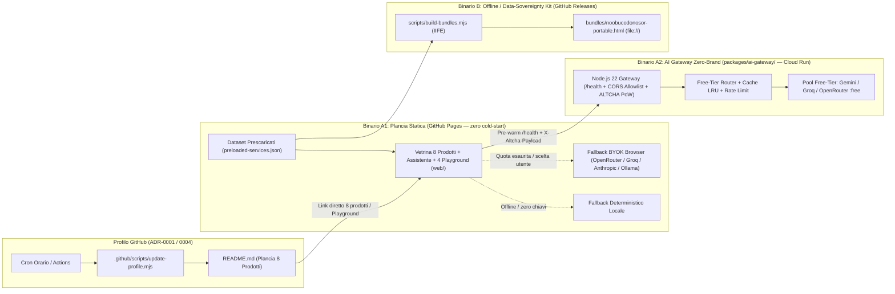

# Architecture Decision Records (ADR) & Master Task Backlog — Noobucodonosor

Questa cartella raccoglie gli **Architecture Decision Records (ADR)** e il **Backlog Operativo** del progetto **Noobucodonosor — Hub Vetrina, Servizi Prescaricati & Profilo GitHub** (`Noobucodonosor/Noobucodonosor`), consolidando le decisioni architetturali, di sicurezza e di prodotto.

---

## Indice degli ADR

| ID | Titolo | Stato | Priorità | Autori / Fonti |
| :--- | :--- | :--- | :--- | :--- |
| **[ADR-0001](./0001-profilo-vetrina-github.md)** | Architettura Core — Profilo & Vetrina GitHub Automatica | Accettato (Baseline) | Core | Noobucodonosor |
| **[ADR-0002](./0002-hub-vetrina-servizi-prescaricati-free-tier.md)** | Hub Vetrina Web, Servizi Prescaricati con Pool API Free-Tier e Pacchetti Locali Separati | Accettato | P1 — Alta | Noobucodonosor |
| **[ADR-0003](./0003-hardening-sicurezza-cost-control.md)** | Hardening, Sicurezza, Cost-Control e Limiti di Scalabilità (~€0) | Accettato | P0 / P1 — Critica & Alta | Noobucodonosor |
| **[ADR-0004](./0004-split-static-hub-and-ai-gateway.md)** | Split Statico/Dinamico (GitHub Pages + Cloud Run), Isolamento AI Gateway e Posizionamento Profilo | Accettato | P0 / P1 — Critica & Alta | Noobucodonosor |

---

## Diagramma Architetturale del Sistema (ADR-0004 Split Statico/Dinamico)

---

## Master Task Backlog (Tutti i Task Censiti)

> **Nota:** Lo stato live (`Open` / `Closed`) di ciascun task è tracciato sulle **GitHub Issues** del repository. Usa `closes #<NumeroIssue>` nei commit per chiuderle automaticamente.

| Task ID | Issue | ADR | Titolo Task | File Coinvolti | Priorità | Assegnatari |
| :--- | :--- | :--- | :--- | :--- | :--- | :--- |
| **TASK-SHOWCASE-01** | `#1` | [ADR-0001](./0001-profilo-vetrina-github.md) | Validazione e fallback per `social-preview.png` e stato API | `.github/scripts/update-profile.mjs` | **P1 — Alta** | Noobucodonosor |
| **TASK-SHOWCASE-02** | `#2` | [ADR-0001](./0001-profilo-vetrina-github.md) | Modalità `--dry-run` per verifica locale dello script | `.github/scripts/update-profile.mjs` | **P2 — Media** | Noobucodonosor |
| **TASK-HUB-01** | `#3` | [ADR-0002](./0002-hub-vetrina-servizi-prescaricati-free-tier.md) | Dataset prescaricati per 7 progetti, Assistente e 4 playground | `web/data/preloaded-services.json` | **P1 — Alta** | Noobucodonosor |
| **TASK-HUB-02** | `#4` | [ADR-0002](./0002-hub-vetrina-servizi-prescaricati-free-tier.md) | Router API Free-Tier multi-provider + Proxy server Node 22 | `server/free-tier-router.mjs`, `server/index.mjs`, `Dockerfile` | **P1 — Alta** | Noobucodonosor |
| **TASK-HUB-03** | `#5` | [ADR-0002](./0002-hub-vetrina-servizi-prescaricati-free-tier.md) | Portale Web Vetrina, Assistente AI e 4 Playground | `web/index.html`, `web/styles.css`, `web/ai-client.js`, `web/app.js` | **P1 — Alta** | Noobucodonosor |
| **TASK-HUB-04** | `#6` | [ADR-0002](./0002-hub-vetrina-servizi-prescaricati-free-tier.md) | Binario separato pacchetto portabile single-file HTML | `scripts/build-bundles.mjs`, `bundles/noobucodonosor-portable.html` | **P1 — Alta** | Noobucodonosor |
| **TASK-HUB-05** | `#7` | [ADR-0002](./0002-hub-vetrina-servizi-prescaricati-free-tier.md) | Allineamento `README.md`, `AGENTS.md` e verifica pre-release | `README.md`, `AGENTS.md`, `docs/adr/README.md` | **P2 — Media** | Noobucodonosor |
| **TASK-HARDENING-01** | `#8` | [ADR-0003](./0003-hardening-sicurezza-cost-control.md) | Router AI per profilo payload & circuit breaker | `server/free-tier-router.mjs`, `tests/free-tier-router.test.mjs` | **P0 / P1** | Noobucodonosor |
| **TASK-HARDENING-02** | `#9` | [ADR-0003](./0003-hardening-sicurezza-cost-control.md) | Hardening proxy HTTP, IP right-to-left & telemetria | `server/index.mjs`, `tests/server-and-bundles.test.mjs` | **P0 — Critica** | Noobucodonosor |
| **TASK-HARDENING-03** | `#10` | [ADR-0003](./0003-hardening-sicurezza-cost-control.md) | Deploy Cloud Run `--max-instances=1` & billing kill-switch | `.github/workflows/`, GCP Pub/Sub | **P0 — Critica** | Noobucodonosor |
| **TASK-HARDENING-04** | `#11` | [ADR-0003](./0003-hardening-sicurezza-cost-control.md) | Sanitizzatore DOM zero-dependency (`setHTML` + `DOMParser`) | `web/app.js`, `scripts/build-bundles.mjs` | **P0 — Critica** | Noobucodonosor |
| **TASK-HARDENING-05** | `#12` | [ADR-0003](./0003-hardening-sicurezza-cost-control.md) | Key Vault ibrido & diagnostica CORS `file://` | `web/ai-client.js`, `scripts/build-bundles.mjs` | **P1 — Alta** | Noobucodonosor |
| **TASK-HARDENING-06** | `#13` | [ADR-0003](./0003-hardening-sicurezza-cost-control.md) | UX zero-click preset, badge 3 livelli & CTA | `web/app.js`, `web/index.html`, `web/styles.css` | **P1 — Alta** | Noobucodonosor |
| **TASK-HARDENING-07** | `#14` | [ADR-0003](./0003-hardening-sicurezza-cost-control.md) | Configurazione agnostica (`showcase.config.json`) & deep-link `?app=` | `showcase.config.json`, `server/`, `web/`, `.github/scripts/update-profile.mjs` | **P1 — Alta** | Noobucodonosor |
| **TASK-HARDENING-08** | `#15` | [ADR-0003](./0003-hardening-sicurezza-cost-control.md) | Estrattore URL leggero anti-SSRF per `kn5` (`POST /api/kn5/extract`) | `server/url-ingestor.mjs`, `server/index.mjs`, `web/`, `tests/url-ingestor.test.mjs` | **P1 — Alta** | Noobucodonosor |
| **TASK-SPLIT-01** | `#16` | [ADR-0004](./0004-split-static-hub-and-ai-gateway.md) | Redazione ADR-0004 (MADR 4.0.0) e aggiornamento indice ADR | `docs/adr/0004-split-static-hub-and-ai-gateway.md`, `docs/adr/README.md` | **P0 — Critica** | Noobucodonosor |
| **TASK-SPLIT-02** | `#17` | [ADR-0004](./0004-split-static-hub-and-ai-gateway.md) | Isolamento zero-brand `packages/ai-gateway/` (router, ALTCHA PoW, CORS allowlist, `/health`) | `packages/ai-gateway/**`, `server/` | **P0 — Critica** | Noobucodonosor |
| **TASK-SPLIT-03** | `#18` | [ADR-0004](./0004-split-static-hub-and-ai-gateway.md) | Workflow CI/CD disaccoppiati (`deploy-pages.yml`, `deploy-gateway.yml` WIF) & Budget Spend Cap | `.github/workflows/`, `packages/ai-gateway/Dockerfile` | **P0 — Critica** | Noobucodonosor |
| **TASK-SPLIT-04** | `#19` | [ADR-0004](./0004-split-static-hub-and-ai-gateway.md) | `showcase.config.json` (`embedPolicy`, `gatewayBaseUrl`, `scooterlab`, `v.i.n.o.`) & `README.md` 1-schermata | `showcase.config.json`, `README.md`, `.github/scripts/update-profile.mjs` | **P1 — Alta** | Noobucodonosor |
| **TASK-SPLIT-05** | `#20` | [ADR-0004](./0004-split-static-hub-and-ai-gateway.md) | Aggiornamento `web/` (CSP `<meta>`, pre-warm `/health`, ALTCHA client, BYOK CORS-safe) | `web/index.html`, `web/ai-client.js`, `web/app.js` | **P1 — Alta** | Noobucodonosor |
| **TASK-SPLIT-06** | `#21` | [ADR-0004](./0004-split-static-hub-and-ai-gateway.md) | Offline Kit `bundles/noobucodonosor-portable.html` (IIFE, storage fallback, export/import JSON) | `scripts/build-bundles.mjs`, `bundles/noobucodonosor-portable.html` | **P1 — Alta** | Noobucodonosor |
