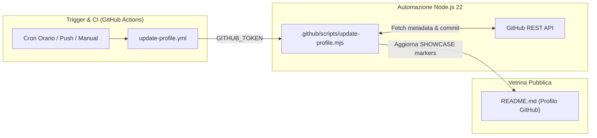

# Architecture Decision Records (ADR) & Master Task Backlog — Noobucodonosor

Questa cartella raccoglie gli **Architecture Decision Records (ADR)** e il **Backlog Operativo** del progetto **Noobucodonosor — Profilo & Vetrina GitHub** (`Noobucodonosor/Noobucodonosor`), consolidando le decisioni architetturali, di sicurezza e di prodotto.

---

## Indice degli ADR

| ID | Titolo | Stato | Priorità | Autori / Fonti |
| :--- | :--- | :--- | :--- | :--- |
| **[ADR-0001](./0001-profilo-vetrina-github.md)** | Architettura Core — Profilo & Vetrina GitHub Automatica | Accettato (Baseline) | Core | Dany |

---

## Diagramma Architetturale del Sistema

---

## Master Task Backlog (Tutti i Task Censiti)

> **Nota:** Lo stato live (`Open` / `Closed`) di ciascun task è tracciato sulle **GitHub Issues** del repository. Usa `closes #<NumeroIssue>` nei commit per chiuderle automaticamente.

| Task ID | Issue | ADR | Titolo Task | File Coinvolti | Priorità | Assegnatari |
| :--- | :--- | :--- | :--- | :--- | :--- | :--- |
| **TASK-SHOWCASE-01** | `#1` | [ADR-0001](./0001-profilo-vetrina-github.md) | Validazione e fallback per `social-preview.png` e stato API | `.github/scripts/update-profile.mjs` | **P1 — Alta** | Dany |
| **TASK-SHOWCASE-02** | `#2` | [ADR-0001](./0001-profilo-vetrina-github.md) | Modalità `--dry-run` per verifica locale dello script | `.github/scripts/update-profile.mjs` | **P2 — Media** | Dany |
